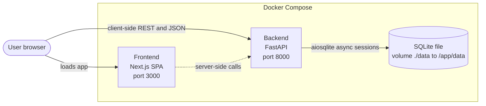
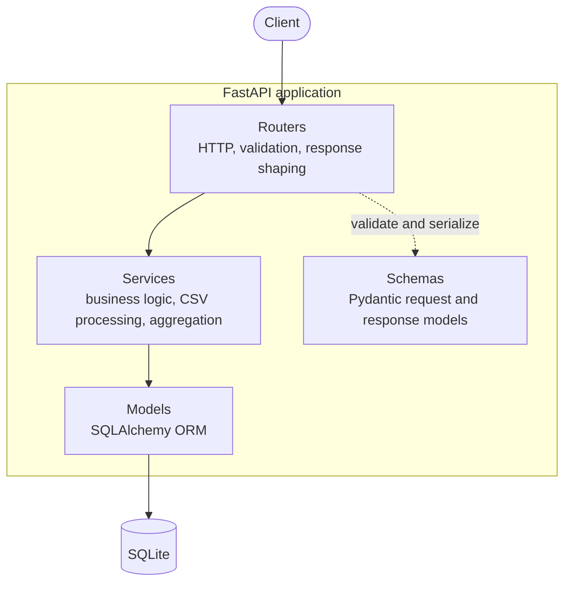
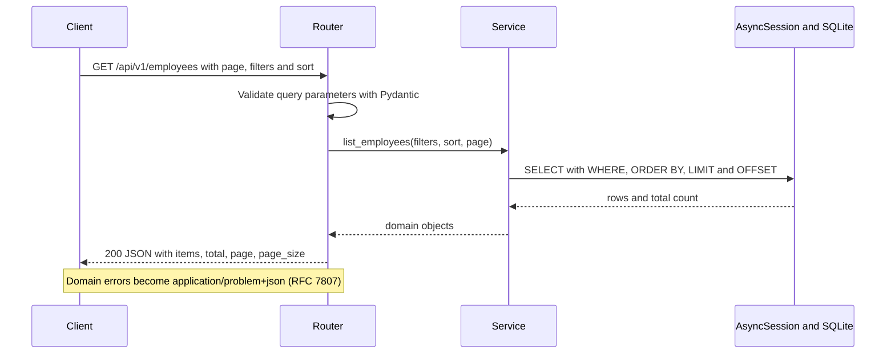
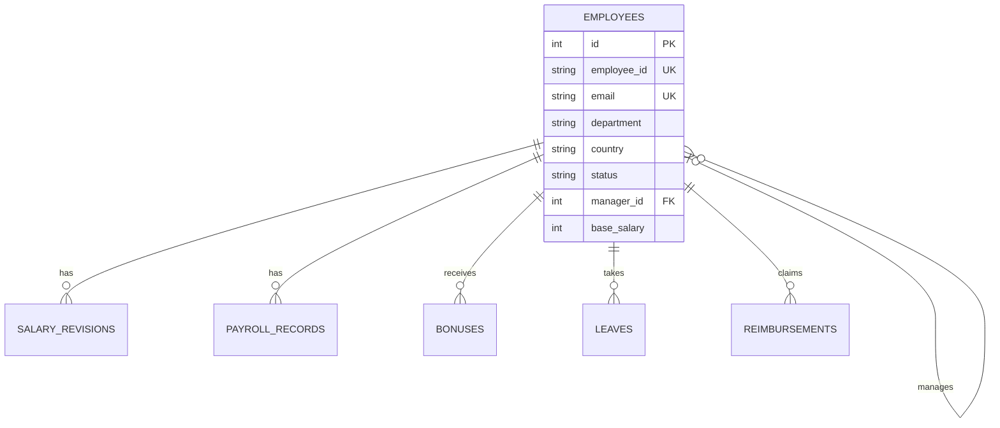
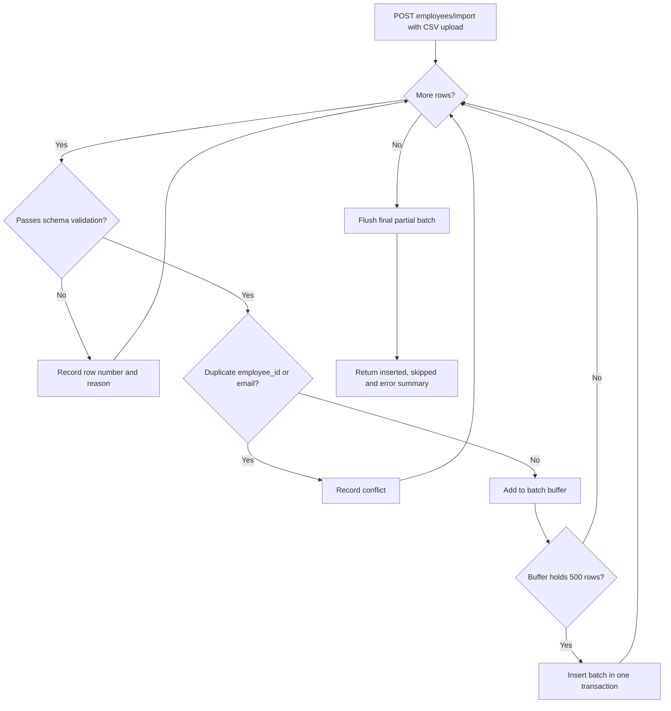
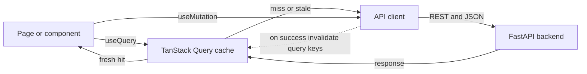

# Architecture Document: Employee Salary Management System

| | |
|---|---|
| **Scope** | v1 (single-node, no authentication) |
| **Stack** | FastAPI, SQLAlchemy (async), SQLite, Next.js, TanStack Query, Docker Compose |

## 1. Summary

The Employee Salary Management System is a monorepo containing a decoupled REST backend and a single-page frontend. The system lets HR users browse and maintain employee records, inspect compensation history (salary revisions, payroll, bonuses, leaves, reimbursements), import and export data as CSV, and view aggregate analytics by department and country.

The design favours simplicity and testability over premature scalability. The target dataset is roughly 10,000 employees, which SQLite handles comfortably. Where the design deliberately takes a shortcut, this document records the shortcut and the trigger for revisiting it (see Section 12).

## 2. Goals and Non-Goals

### Goals

- CRUD management of employees with server-side pagination, filtering and sorting.
- Read access to per-employee compensation history.
- Bulk CSV import (streamed, batched) and CSV export.
- Analytics endpoints returning pre-aggregated data (KPIs, distributions, department and country breakdowns).
- One-command local startup via Docker Compose.
- Clear layering so business logic can be unit-tested without HTTP or a real database.

### Non-Goals (v1)

- Authentication, authorization and audit logging.
- Multi-node deployment or high-concurrency writes.
- Payroll execution (the system records payroll data; it does not compute or disburse pay).
- Real-time updates (no websockets or server push).

## 3. System Context and Deployment Topology

Two containers run under Docker Compose. The browser talks to the Next.js frontend on port 3000, and the SPA calls the FastAPI backend on port 8000 over JSON/REST. The backend owns a SQLite file stored on a bind-mounted volume so data survives container restarts.



**Deployment notes**

- The `./data:/app/data` volume is the only stateful component. Back it up as a file.
- `depends_on` orders container start but does not wait for the backend to be healthy. Add a `/healthz` endpoint and a Compose `healthcheck` so the frontend only starts once the API responds.
- See Risk R1 in Section 11 regarding `NEXT_PUBLIC_API_URL`.

## 4. Backend Architecture

### 4.1 Layering

The backend uses four layers with strictly downward dependencies.

| Layer | Responsibility | Rules |
|---|---|---|
| **Routers** | HTTP concerns: routing, request validation, status codes, response shaping | Thin. No business logic and no direct query construction. |
| **Services** | Business logic: filtering rules, salary calculations, CSV parsing and validation, aggregation orchestration | Framework-agnostic. Receive an `AsyncSession` and return domain objects or schema-ready data. |
| **Models** | SQLAlchemy ORM entities | Single source of truth for the schema. |
| **Schemas** | Pydantic request and response models | Never expose ORM objects directly through the API. |

### 4.2 Request Lifecycle

A request passes through validation in the router, is delegated to a service that runs queries on an async session, and is serialized back through a response schema. The session is provided per request via a FastAPI dependency and is closed (and rolled back on error) when the request finishes.

Layer dependencies run strictly downward. Schemas sit beside the stack and are used by routers to validate and serialize.



A typical list request flows as follows.



### 4.3 Key Design Decisions

1. **Async SQLAlchemy with `aiosqlite`.** FastAPI is async-native, so blocking database calls would stall the event loop. `aiosqlite` runs SQLite operations on a worker thread behind an async interface.
2. **No separate repository layer.** Services issue SQLAlchemy queries directly. At this scale, a repository abstraction would add indirection without enabling anything we need. If we move to multiple data sources, or if query logic starts to be duplicated across services, introduce repositories at that point.
3. **Offset/limit pagination.** Simple, supports random page access and is adequate for 10K rows. Cursor pagination only becomes worthwhile if the dataset grows by orders of magnitude or if deep paging shows measurable latency.
4. **Errors as RFC 7807 Problem Details.** A global exception handler maps domain exceptions (not found, validation, conflict) to `application/problem+json` so clients get one consistent error shape.

## 5. Data Model

`employees` is the aggregate root. Five child tables hang off it in one-to-many relationships, and `employees.manager_id` is a self-referencing foreign key that forms the reporting hierarchy.



| Table | Relationship | Purpose |
|---|---|---|
| `employees` | root, self-referencing via `manager_id` | Identity, department, country, status, base salary |
| `salary_revisions` | 1:N | History of base-salary changes |
| `payroll_records` | 1:N | Per-period pay records |
| `bonuses` | 1:N | Bonus grants |
| `leaves` | 1:N | Leave records |
| `reimbursements` | 1:N | Expense reimbursements |

### 5.1 Modelling Conventions

- **Money**: store as integer minor units (or `Numeric` with fixed scale), never floating point. SQLite has no native decimal type, so this must be enforced in the model layer and covered by tests. Store the currency code alongside amounts, since employees span multiple countries.
- **Identifiers**: a surrogate integer primary key for joins, plus a unique business key `employee_id` exposed to users. Keep the distinction explicit in the API (see Open Question Q2).
- **Timestamps**: `created_at` and `updated_at` on every table, stored in UTC.
- **Deletion**: the endpoint list includes `DELETE`. Recommend soft delete (`status = inactive` plus `deleted_at`) because payroll and revision history must remain referentially intact. Hard delete should cascade only in non-production environments.
- **Manager hierarchy**: enforce `manager_id != id` with a check constraint, and detect cycles in the service layer on update.

### 5.2 Indexing Strategy

| Index | Type | Reason |
|---|---|---|
| `employees.employee_id` | Unique | Fast business-key lookup |
| `employees.email` | Unique | Integrity constraint |
| `employees.department` | Non-unique | Frequent filter and `GROUP BY` |
| `employees.country` | Non-unique | Frequent filter and `GROUP BY` |
| `employees.status` | Non-unique | Active/inactive filtering |
| `salary_revisions.employee_id` | Non-unique | FK join |
| `payroll_records.employee_id` | Non-unique | FK join |

Gaps worth closing: `bonuses`, `leaves`, `reimbursements` also need `employee_id` indexes, since each has a per-employee endpoint. SQLite does not index foreign keys automatically. Consider a composite index such as `(department, status)` if profiling shows the combined filter is hot, and `(employee_id, effective_date)` on `salary_revisions` for ordered history reads.

## 6. API Design

### 6.1 Conventions

| Concern | Convention |
|---|---|
| Versioning | URL prefix `/api/v1/` |
| Pagination | `?page=1&page_size=20`, with an enforced maximum `page_size` (for example 100) |
| Filtering | Query parameters, e.g. `?department=Engineering&country=US&status=active` |
| Sorting | `?sort_by=base_salary&sort_order=desc`, validated against an allow-list of columns |
| Errors | RFC 7807 Problem Details |
| Format | JSON; CSV only for import and export |

Paginated responses should return `items`, `total`, `page` and `page_size` so the UI can render pagination controls without a second call.

### 6.2 Endpoints

| Method | Path | Description |
|---|---|---|
| GET | `/api/v1/employees` | List employees (paginated, filterable, sortable) |
| POST | `/api/v1/employees` | Create employee |
| GET | `/api/v1/employees/{id}` | Get employee |
| PUT | `/api/v1/employees/{id}` | Update employee |
| DELETE | `/api/v1/employees/{id}` | Delete employee |
| GET | `/api/v1/employees/{id}/salary-history` | Salary revisions |
| GET | `/api/v1/employees/{id}/payroll` | Payroll records |
| GET | `/api/v1/employees/{id}/bonuses` | Bonuses |
| GET | `/api/v1/employees/{id}/leaves` | Leaves |
| GET | `/api/v1/employees/{id}/reimbursements` | Reimbursements |
| POST | `/api/v1/employees/import` | CSV import |
| GET | `/api/v1/employees/export` | CSV export |
| GET | `/api/v1/analytics/dashboard` | Dashboard KPIs |
| GET | `/api/v1/analytics/salary-distribution` | Salary distribution |
| GET | `/api/v1/analytics/department-breakdown` | Department aggregation |
| GET | `/api/v1/analytics/country-breakdown` | Country aggregation |

**Implementation caveat: route ordering.** `/employees/import` and `/employees/export` share a prefix with `/employees/{id}`. FastAPI matches routes in registration order, so the static routes must be registered before the parameterized one, or `import` and `export` will be captured as an `{id}`. Add a routing test that asserts this.

### 6.3 CSV Import

Import is the most operationally sensitive flow, so it is specified in detail.

- The upload is read as a stream and parsed row by row, so memory use stays flat regardless of file size.
- Rows are validated through the same Pydantic schema used by `POST /employees`, so there is one definition of a valid employee.
- Valid rows are inserted in batches of 500 inside a transaction per batch.
- Invalid rows are collected with their row number and reason, and returned in the response. A bad row does not abort the whole import.
- Duplicate `employee_id` or `email` values are reported as conflicts, not silently overwritten.
- The response summarizes `inserted`, `skipped` and `errors`.

The import runs synchronously inside the request for v1. At 10K rows this should complete in seconds. If imports grow beyond a reasonable HTTP timeout, move to a background task with a job-status endpoint.

The import pipeline processes one row at a time and only touches the database when a batch fills.



### 6.4 Analytics

All aggregates (dashboard KPIs, distributions, department and country breakdowns) are computed in the database with `GROUP BY` and returned as ready-to-render payloads. The frontend performs no aggregation over raw records. Salary distribution should use fixed server-defined buckets so charts are stable between requests.

## 7. Frontend Architecture

### 7.1 Routes

| Route | View |
|---|---|
| `/` | Dashboard (analytics overview) |
| `/employees` | Employee table with search and filters |
| `/employees/new` | Create employee form |
| `/employees/[id]` | Employee detail, tabbed: info, salary history, payroll, bonuses, leaves, reimbursements |
| `/employees/[id]/edit` | Edit employee form |
| `/import` | CSV import |

### 7.2 State Management

- **Server state**: TanStack Query handles fetching, caching, background refetch and invalidation. Query keys encode filter, sort and page parameters so each combination is cached independently.
- **UI state**: local `useState` / `useReducer`. A global store is unnecessary at this scale.
- **Mutations** invalidate the affected query keys (for example, a successful update invalidates the employee detail and list queries).
- Detail tabs load lazily, so opening an employee does not fire five requests up front.

Reads go through the query cache, and writes invalidate the keys they affect.



### 7.3 Component Organization

```
components/
  layout/      AppLayout, Sidebar, Header
  employees/   EmployeeTable, EmployeeForm, EmployeeDetail
  analytics/   DashboardCards, SalaryChart, DepartmentPie
  common/      SearchInput, FilterPanel, ExportButton
  ui/          Ant Design wrappers and overrides
```

Filter state should live in the URL query string so views are shareable and survive a refresh. Search input should be debounced.

## 8. Performance

| Area | Approach | Expectation |
|---|---|---|
| Reads | Indexed filters and sorts | Single-digit milliseconds at 10K rows |
| Lists | Server-side pagination | Browser never holds the full dataset |
| Analytics | Database-side aggregation | No client computation on large sets |
| Import | Streaming parse, 500-row batches | Bounded memory |
| Frontend | TanStack Query cache | Fewer redundant network calls |

**SQLite configuration.** Enable WAL mode (`PRAGMA journal_mode=WAL`), set `busy_timeout`, and enable `foreign_keys=ON` on every connection, since SQLite leaves foreign-key enforcement off by default. WAL lets reads proceed during a write, but SQLite still permits only one writer at a time. That is acceptable for this workload and is the main reason for the PostgreSQL migration path in Section 10.

## 9. Testing Strategy

| Level | Scope | Tooling |
|---|---|---|
| Unit | Service logic: salary calculations, CSV validation, aggregation shaping | pytest with an in-memory SQLite session |
| API | Routers end to end with a test database: status codes, pagination, filtering, error format, route ordering | pytest with an async HTTP client |
| Frontend | Component and hook behaviour, including loading and error states | Jest and React Testing Library |
| Smoke | Compose stack starts, health check passes, a list request succeeds | Script run in CI |

The service layer's isolation from HTTP is what makes the unit tier cheap. Keep it that way: no `Request` or `Response` objects in services.

## 10. Architecture Decision Records (Summary)

| # | Decision | Alternatives considered | Rationale | Revisit when |
|---|---|---|---|---|
| ADR-1 | Async SQLAlchemy with `aiosqlite` | Sync SQLAlchemy | Matches FastAPI's async model | Moving to PostgreSQL (switch driver to `asyncpg`) |
| ADR-2 | No repository layer | Repository per aggregate | Avoids indirection at this scale | Query logic is duplicated across services |
| ADR-3 | Offset/limit pagination | Cursor pagination | Simple, supports page jumps, fine for 10K rows | Dataset grows by orders of magnitude |
| ADR-4 | TanStack Query, no global store | Redux, Zustand | Nearly all state is server state | Significant cross-page client state appears |
| ADR-5 | Database-side analytics | Client-side aggregation | Keeps payloads small and logic testable | Analytics latency becomes noticeable (add caching or materialized views) |
| ADR-6 | REST with versioned prefix | GraphQL | Small, stable resource set | Clients need flexible, nested queries |
